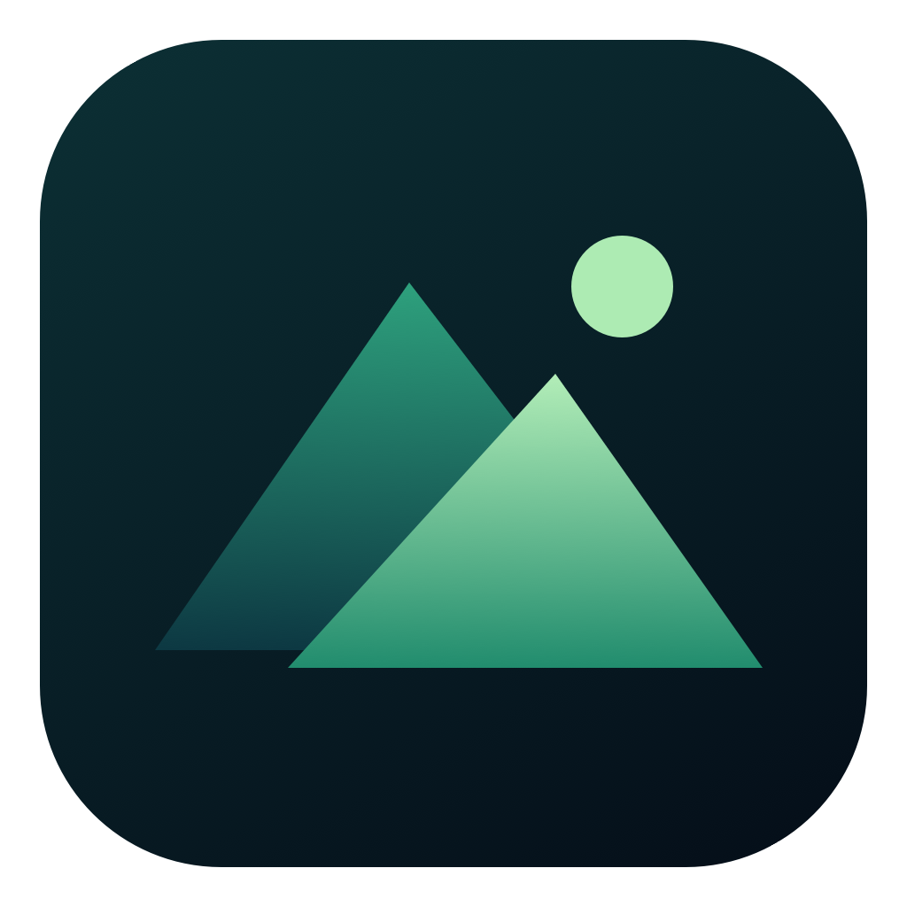

# OpenWall



A free, independent, open-source live wallpaper app for macOS. MIT licensed.
Written from scratch in Swift, SwiftUI, AppKit, and AVFoundation. No third-party
packages, account, subscription, license key, analytics, or network requests.
No Wallper code, assets, APIs, or services are used.

**[Download for Apple Silicon](https://github.com/satwik404-eng/OpenWall/releases/latest/download/OpenWall-macOS-arm64.zip)**
 · **[All releases](https://github.com/satwik404-eng/OpenWall/releases)**
 · **[MIT license](LICENSE)**

## Download and install

The prebuilt app requires an **Apple Silicon Mac (M1 or later), macOS 14+**.
This is an early release, tested on one Mac; see [validation](VALIDATION.md).

1. Download the ZIP above and extract it, or download the DMG from the latest release.
2. Move **OpenWall.app** into **Applications**. With the DMG, drag it onto the Applications shortcut.
3. Open OpenWall, pick a wallpaper or import a video, and click **Set wallpaper**.

**Code signing:** this free build is ad-hoc signed, **not Apple-notarized**.
macOS may block the first launch. You can review and build the source yourself,
or, if you choose to trust the downloaded app, use Apple's documented
[Privacy & Security → Open Anyway procedure](https://support.apple.com/102445).
Release assets include SHA-256 checksums so you can verify the download.

Intel Mac users can build from source on an Intel Mac; no prebuilt Intel download
is supplied and Intel execution has not been verified.

## Use the app

1. Open the supplied **OpenWall.app**. You can move it to `/Applications`.
2. Pick **Northern lights**, **Afterglow**, or **Deep current**, then click
   **Set wallpaper**. These original animated designs are generated from code.
3. Use **Import videos** (Command-O) to add your own videos. Supported formats
   depend on the codecs available in macOS; MP4 H.264/HEVC and MOV are good choices.
4. Choose **All displays** or a particular display before applying a wallpaper.
5. The menu bar mountain icon has pause, shuffle, stop, and quit controls.
   Closing the library window keeps wallpapers running.
6. **Stop** or **Quit** removes OpenWall's desktop windows, revealing your
   existing wallpaper immediately. macOS wallpaper settings are never rewritten.

Videos loop silently with aspect-fill cropping. **Pause in full screen** is
enabled by default: when the active app covers a display, OpenWall pauses all
video and procedural wallpapers. It resumes when you return to the desktop,
unless you paused manually or another automatic pause still applies. This also
handles full-screen video and display-covering windows, including the camera
housing safe area on MacBooks. You can turn it off in Settings.

Detection uses window bounds and process IDs, without reading window titles or
capturing the screen. App/Space changes trigger a check, with a two-second
fallback for in-window full-screen transitions (up to roughly 2.5 seconds with
timer coalescing). Checks stop while already paused manually, on battery with
battery pause enabled, asleep, or without an active wallpaper. Repeated checks
do not restart playback or rebuild an unchanged procedural renderer.

Other settings include video speed, battery pause (checked every 15 seconds),
timed shuffle, and optional login startup. Login startup uses Apple's SMAppService and may need approval in
System Settings. Move the app to Applications before enabling it.

## Local storage

Imported videos are **copied**, not moved, to
`~/Library/Application Support/org.openwall.desktop/Media/`. Thumbnails and
`library.json` live alongside that folder. Removing a video from OpenWall
deletes its library copy, leaving your original file untouched. Settings and
per-display wallpaper choices are restored when you reopen the app.

Do not delete source videos until import has finished. Very large videos need
enough free disk space for a complete local copy. If the library JSON cannot
be decoded, the app reports it and leaves the file untouched until a later
user action saves new settings.

## Build from source

Requires macOS 14+, Apple command line developer tools, and a Swift compiler
that supports macOS 14 SwiftUI. This build was made on Apple Silicon; build
on an Intel Mac for an Intel binary. There are no package downloads.

```sh
chmod +x build.command
./build.command
open ../OpenWall.app
```

The optional first argument is the output `.app` path. The build script signs
locally with an ad-hoc signature. This is **not Apple notarization**; public
distribution would require a Developer ID signature/notarization for a smooth
Gatekeeper experience. The complete source can be freely inspected and built.

## Scope and limitations

- Desktop wallpapers only. No lock screen integration or screen saver extension.
- No hosted wallpaper catalog, proprietary downloads, or music-player integration.
- Full-screen/display-covering app detection, battery pause, and display-sleep
  pause are included. CPU-load detection is not included.
- Artwork fills a desktop-level, noninteractive window beneath desktop icons.
  macOS Spaces/Stage Manager behavior can vary; those combinations need testing.
- Disconnected display choices are retained and used when the display returns.
- Video wallpapers can consume GPU/video-decoder resources. Pause or quit when needed.
- Multi-monitor, future sleep/wake cycles, and login startup need verification
  on the target configuration; see `VALIDATION.md` for what was actually tested.

## Source map

- `Sources/Library.swift`: imports, persistence, preferences, display assignments.
- `Sources/Engine.swift`: desktop windows, video loops, power detection, motion artwork.
- `Sources/FullScreenDetector.swift`: privacy-preserving display coverage detection.
- `Sources/Views.swift`: native library and menu bar interface.
- `Sources/OpenWallApp.swift`: app scenes and lifecycle.

OpenWall is not affiliated with Wallper or Sandimax. Videos you import keep
their original licenses; the MIT license covers OpenWall's source and original artwork.
